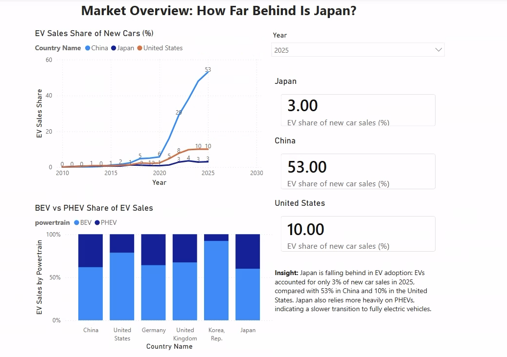
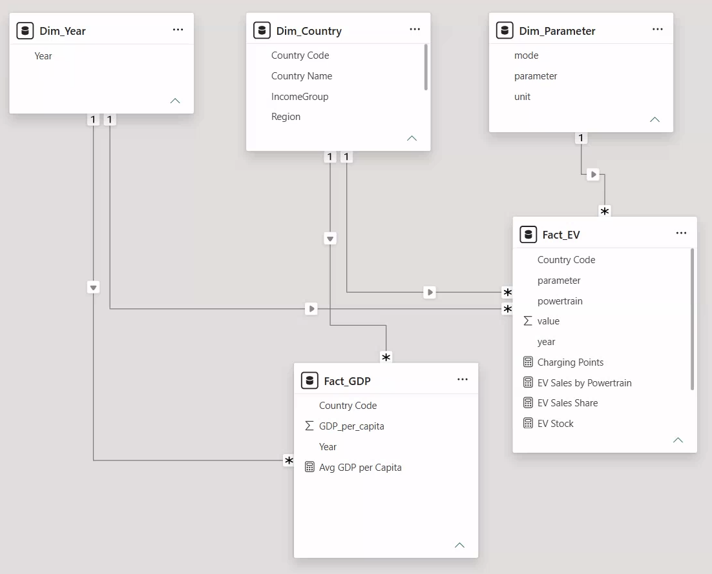
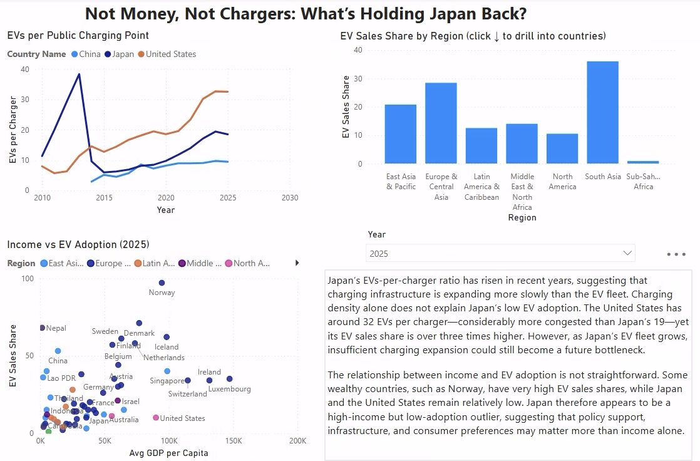

# japan-ev-adoption-powerbi
Power BI analysis of Japan's EV adoption gap using IEA and World Bank data
# Japan's EV Adoption Gap: Market Trends and Key Drivers
**日本のEV普及の遅れ：市場動向と主要因の分析**

[English](#english) | [日本語](#japanese)

---

## English

Power BI report analyzing why Japan, a global automotive leader, lags behind China and the United States in electric vehicle (EV) adoption.

### Key Insights
- **The gap is widening:** In 2025, EVs accounted for ~3% of new car sales in Japan, compared with 10% in the U.S. and 53% in China.
- **Charging infrastructure is not the main constraint:** Japan has ~19 EVs per public charger vs. ~32 in the U.S., yet the U.S. EV share is more than three times higher.
- **Income does not explain the gap:** Countries with similar GDP per capita (Korea, Czechia, Spain, Portugal) have 3–13x Japan's EV share.
- **Japan leans toward plug-in hybrids:** Japan has the highest PHEV share (~40%) among six major markets.

### Approach
- **Data preparation (Power Query):** Filtered historical records, removed regional aggregates, reshaped World Bank data, and standardized country names to ISO3 codes (5,796 rows, 100% matched).
- **Data model:** 5-table star schema following 3NF (Dim_Country, Dim_Year, Dim_Parameter, Fact_EV, Fact_GDP).
- **DAX measures:** Unit-safe measures, KEEPFILTERS for powertrain breakdown, DIVIDE for ratios.
- **Interactivity:** Year slicer, Geography drill-down hierarchy (Region → Country), page navigation.

### Report Pages
| Page | Content |
|---|---|
| Market Overview | EV share trend, KPI cards, BEV/PHEV mix |
| Drivers | EVs per charger, income vs. EV share, regional drill-down |
| Methodology | Data cleaning, data model, measures, limitations |

### Data Sources
- [IEA Global EV Outlook 2026 Data](https://www.iea.org/data-and-statistics/data-product/global-ev-outlook-2026)
- [IEA Global EV Data Explorer](https://www.iea.org/data-and-statistics/data-tools/global-ev-data-explorer)
- [World Bank GDP per capita (NY.GDP.PCAP.CD)](https://data.worldbank.org/indicator/NY.GDP.PCAP.CD)

### Limitations
The analysis identifies associations, not causation. IEA country data covers ~61 countries, and conventional hybrid (HEV) data is not included.

### Tools
Power BI Desktop · Power Query · Power Pivot · DAX · Excel

---

## 日本語

自動車大国である日本が、なぜ中国や米国に比べて電気自動車（EV）の普及で遅れているのかを分析した Power BI レポートです。

### 主な分析結果
- **差は拡大している：** 2025年の新車販売に占めるEV比率は、日本が約3%、米国が10%、中国が53%。
- **充電インフラは主な要因ではない：** 公共充電器1基あたりのEV台数は日本が約19台、米国が約32台。米国の方が充電環境は逼迫しているにもかかわらず、EV比率は日本の3倍以上。
- **所得水準では説明できない：** 1人当たりGDPが日本と同程度の国（韓国、チェコ、スペイン、ポルトガル）は、日本の3〜13倍のEV比率。
- **日本はPHEVの比率が高い：** 主要6市場の中で、日本のPHEV比率が最も高い（約40%）。

### 分析手法
- **データ前処理（Power Query）：** 実績データの抽出、地域集計行の除外、World Bankデータの縦持ち変換、国名をISO3コードに統一（5,796行すべてマッチ）。
- **データモデル：** 第3正規形に基づく5テーブルのスタースキーマ（Dim_Country、Dim_Year、Dim_Parameter、Fact_EV、Fact_GDP）。
- **DAXメジャー：** 単位の異なる指標を分けて集計、KEEPFILTERSによるパワートレイン別の内訳表示、DIVIDEによる比率計算。
- **インタラクティブ機能：** 年スライサー、地域→国のドリルダウン階層、ページナビゲーション。

### データソース
- [IEA Global EV Outlook 2026 Data](https://www.iea.org/data-and-statistics/data-product/global-ev-outlook-2026)
- [IEA Global EV Data Explorer](https://www.iea.org/data-and-statistics/data-tools/global-ev-data-explorer)
- [World Bank GDP per capita (NY.GDP.PCAP.CD)](https://data.worldbank.org/indicator/NY.GDP.PCAP.CD)

### 留意点
本分析は相関関係を示すものであり、因果関係を証明するものではありません。IEAの国別データは約61か国が対象で、従来型ハイブリッド車（HEV）のデータは含まれていません。

### 使用ツール
Power BI Desktop・Power Query・Power Pivot・DAX・Excel
